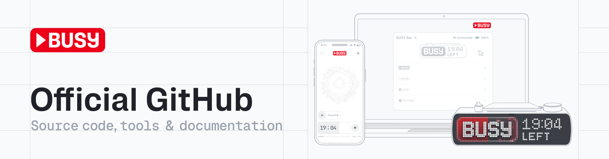

<picture>
    <source media="(prefers-color-scheme: dark)" srcset="https://raw.githubusercontent.com/busy-app/.github/main/profile/dark_theme_banner.png">
    <source media="(prefers-color-scheme: light)" srcset="https://raw.githubusercontent.com/busy-app/.github/main/profile/light_theme_banner.png">
    
</picture>

### Welcome to the official BUSY GitHub

This is where we publish source code, tools, and resources for BUSY products: BUSY App and BUSY Bar.\
We build tools that help people focus, and we share how they work.

🛒 Official store & downloads → [busy.app](https://busy.app/)\
📚 Documentation → [docs.busy.app](https://docs.busy.app/)

## BUSY Bar

A productivity multi-tool with an LED pixel screen for custom statuses. Built-in Pomodoro timer and apps. Fully customizable, open-source, and hacker-friendly.

### Firmware

- [busybar-firmware](https://github.com/busy-app/busybar-firmware) — BUSY Bar firmware source code

### Client libraries

Control BUSY Bar from your own code:

- [busylib-py](https://github.com/busy-app/busylib-py) — Python library
- [busylib-ts](https://github.com/busy-app/busylib-ts) — TypeScript library
